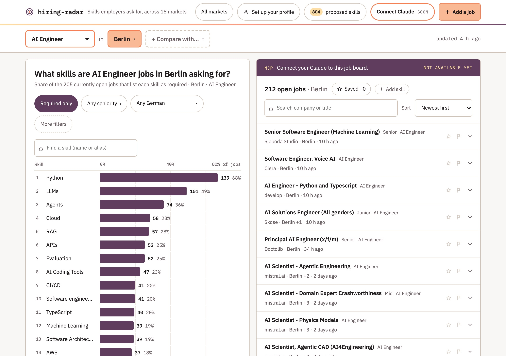
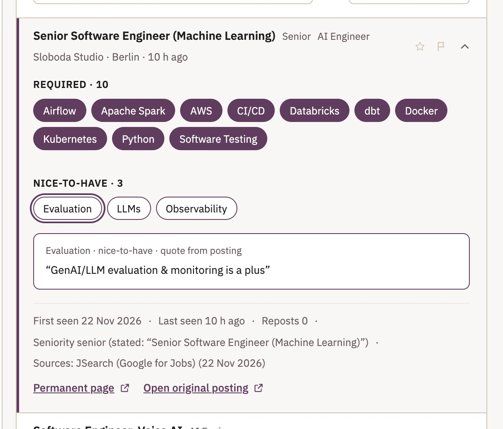

# hiring-radar

**What skills do AI and data jobs actually ask for, and how does that differ by city?**

hiring-radar collects job postings from company job boards and job feeds every day. A
language model reads each posting and lists the skills it asks for, from a fixed list of
skills, with the sentence each one came from. The dashboard then shows what share of open
jobs in a city ask for each skill. One posting that says "Python" five times counts once.

It is for people looking for AI and data roles who want to know what to learn next, and
which cities want what they already know.

Every choice behind it, and what was rejected, is written down in
[DECISIONS.md](DECISIONS.md) (choices up to 16 Nov 2026) and [decisions/](decisions/) (one
file per choice after that).

**As of 22 Nov 2026:**

| | |
|---|---|
| Markets | 15: 14 cities in 4 countries (Germany, United States, United Kingdom, Netherlands), plus remote jobs open across the EU |
| Feeds polled | 128 switched on (131 configured) |
| Open jobs | 1,434, from 747 companies |
| Labelled postings | 131: 71 for tuning, 60 held out |
| Held-out F1 | 0.945, measured 20 Nov 2026, for the planned cheaper extractor (see below). The extractor running today last scored 0.919 on the held-out set, 30 Oct 2026 |

What that looks like: Python is required by 70% of open AI and data jobs in Berlin, 56% in
San Francisco and 65% in London. RAG (building answers from retrieved documents) is
required by 24% in Berlin but 7% in San Francisco.



You pick a job family and a city, and get that market's chart and its open jobs. Every
market has its own address (`/berlin/ai-engineer`), so a link to one opens the same view
for anyone. "Compare with" puts two or three cities side by side. More screens are in
[docs/screens/](docs/screens/).

Each job also gets its seniority, whether it requires German, what degree it asks for,
and whether it asks for production experience. Jobs are sorted into six families by
title: AI Engineer, ML Engineer, Data Scientist, ML Platform, Research and Forward Deployed
Engineer.

You can describe yourself once (role, seniority, German, degree, the skills you have).
The dashboard then shows how much of each job's ask you cover and which in-demand skills
you are missing. Your profile stays in your browser. The server never sees it, so there
is no account.

**What it is not:** it does not rewrite your CV, read your email, count applicants or use
LinkedIn. The predecessor did some of that, and it was cut on purpose (DECISIONS.md,
2026-10-16).

---

## Why trust the numbers

A chart built by a language model is only as good as the reading behind it. So the
reading is measured, not assumed.

**A labelled set.** 131 real postings have an answer key: the skills each one asks for,
whether each is required or nice-to-have, and the exact words that say so. Two models
from two companies (Claude Opus 5.5 and GPT-6.1) label each posting without seeing each
other's answer. Where they agree, the label stands. Where they disagree, a third model
(Gemini 4) judges the item, and I settle what is still split by hand: 453 labels across
101 of the 131 postings. I also ran a blind spot-check of 30 labels the models agreed on,
drawn at random from the sealed held-out set and shown without the models' answers: 0
errors (95% interval 0–11%, so it bounds the error rate rather than proving it zero). The
labelling rules and the spot-check protocol are in [evals/LABELING.md](evals/LABELING.md).

**A held-out split.** 71 of the labelled postings are used to tune the extractor. The
other 60 are sealed: nobody tunes against them, and they are read only at release points.
A score on postings you tuned on can turn into a score of how well you memorised them;
the sealed set checks for that.

**A regression gate.** Any change to the extractor's instructions or to the skill list
must run the evaluation on the tuning set before it can merge. The result is committed
with the change, and the next change is measured against it. A CI check stops a pull
request that skips this.

What it caught: on 17 Nov an evaluation run showed six degree misses with the same
shape. The posting said "a bachelor's or master's degree" and the model recorded a
master's. On the dashboard, that hid the job from anyone filtering by a bachelor's. The
fix told the model to record the lowest level named, as the answer keys do. Degree
accuracy on the tuning set went from 0.887 to 0.972: 7 postings went from wrong to right,
none from right to wrong. ([PR #224](https://github.com/chandlershortlidge/hiring-radar/pull/224))

The gate has also paused three changes because one score fell past its stop line. Each
time a person looked, and the drop was within that score's normal swing between runs, so
the change merged and the paused run became the new baseline.

**A quote behind every skill.** Each extracted skill stores the sentence it came from.
Open a job on the dashboard and click a skill to see the quote, so any number on the
chart can be traced back to the posting's own words.



**A review queue for unknown skills.** The skill list is a versioned file
([taxonomy/skills.json](taxonomy/skills.json), 254 skills), not part of the prompt. When
the model finds a skill that is not on the list, it never reaches the chart. It goes to a
review queue instead (804 waiting today). A skill joins the list only after review.

### The switch to a cheaper model

The extractor runs on Claude Sonnet 5.5 today. It is moving to Claude Haiku 5.5, which
costs about an eighth as much per posting ($0.0021 against $0.0167 on the sealed set).

How it was decided: both models ran on the tuning set, and Haiku's instructions were
improved over three rounds. Because that tuning could have fitted the tuning set, the
deciding test was one run on the 60 sealed postings, with nothing changed afterwards.
Haiku kept its lead there: F1 0.945 against Sonnet's 0.922 (about 0.009 once one posting
where Sonnet ran out of output room is set aside).

What it costs: Haiku misses broad skills more often. On the sealed set it missed "cloud"
in 10 of 180 readings, against Sonnet's 2. It is also slightly worse at seniority, about
one posting in 60. These are recorded and not fixed, because fixing them from the sealed
postings would stop the sealed set being an honest test.

The decision and the full table:
[decisions/2026-11-20-hir-383-sealed-check-for-cheaper-model.md](decisions/2026-11-20-hir-383-sealed-check-for-cheaper-model.md).
The switch itself, with one full re-read of every stored job, is still to be done.

---

## How it's built and run

```
company job boards, job feeds, a pasted link, pasted text or a screenshot
        │
        ├─ screenshot only → a vision model transcribes it word for word   (app/transcribe.py)
        ▼
  ingest: is this posting new, still listed, a duplicate, or a repost?     (app/ingest.py)
        │   kept only if the title is an AI/data role and the city is one we cover;
        │   recruiting agencies are screened out
        ▼
  extract: one model call per posting → skills from the list, each         (app/extract.py)
        │   required or nice-to-have, each with its quote; plus seniority,
        │   German, degree and production experience, each with a quote
        │   a skill not on the list → the review queue, never the chart
        ▼
  aggregate: share of open jobs per skill, per city and job family         (app/queries.py)
        │
        ├─ dashboard (React)                                               (web/)
        └─ MCP server: the same queries as tools for anyone's Claude       (app/mcp_server.py)
```

A posting under 400 characters is a fragment and stays out of the chart.

**Stack.** Python 3.13 with `uv` and FastAPI. The Anthropic SDK is called in-process.
SQLite, one file, with numbered migrations. React 18 and Vite for the dashboard, with no
chart library (the bars are CSS), served by the same process.

**Deployment.** One small Google Cloud VM in Frankfurt runs the app behind Caddy (HTTPS).
On it:

- **Two collections a day**: Europe at 07:00 Berlin time, the US at 07:00 New York time.
- **A nightly backup** of the database to a storage bucket, kept 30 days.
- **A caretaker** runs every morning at 10:00. It checks each job source: a board that is
  gone, has posted nothing for days, or changed shape is paused or moved to its new
  address. A city whose open jobs fell sharply overnight raises an alert. It calls no
  model and never deletes jobs.

From GitHub Actions:

- **CI on every pull request**: the Python tests, a frontend build, the regression gate
  above, and a rules gate (below). A pull request that changes the dashboard also gets
  before-and-after screenshots against the live data.
- **Deploy on merge**: every merge to `main` is deployed to the VM.
- **A robot visitor after each deploy**: a headless browser walks the live site's main
  paths. If it fails, the site is rolled back to the last version that passed, and a
  ticket is filed. It also runs every morning after the collection.
- **An uptime check** every five minutes from outside the VM.

How to operate, rebuild and restore it: [deploy/README.md](deploy/README.md).

**How the code gets written.** Most changes are made by AI coding agents, under rules
written down in the repo:

1. Work starts as a ticket in Linear, with what "done" means and what is out of scope.
2. A lead agent runs several times a day. It picks the tickets that can run without a
   person, in the agreed order, and starts one coding agent per ticket, each on its own
   branch.
3. Each pull request goes to a separate reviewer agent that did not write it. It checks
   the change against the ticket and the repo's rules, then merges it or sends it back
   with the exact fixes.
4. A rules gate in CI stops any pull request that changes the agents' own rules, or
   deletes or skips a test, until Chandler has approved it in writing. The reviewer
   cannot switch this off, because the check runs from `main`, not from the pull request.

The rules are in [AGENTS.md](AGENTS.md).

---

## Connect your Claude (MCP)

hiring-radar has an MCP server: a way for any Claude (claude.ai, the desktop app, Claude
Code) to call it as a set of tools. The tools read the same queries as the dashboard, so
the two cannot disagree. They only read: no tool writes or calls a model. There is no
sign-in, and each connection is rate limited (about 60 requests a minute; an address that
many connections share, such as an assistant's own servers, about 300).

The tools today:

| tool | what it answers |
|---|---|
| `search_jobs` | open jobs, with every dashboard filter (skills, city, seniority, German, degree, production experience, job family, time window), up to 50 per call |
| `search_postings` | how many jobs mention some words in their posting text ("Claude", "visa sponsorship"), split by city and job family, with the matching jobs |
| `get_job` | one job in full: its text, required and nice-to-have skills, and attributes |
| `skill_demand` | the chart: share of open jobs asking for each skill |
| `related_skills` | the related-skills panel: what else the jobs asking for given skills ask for, with how much more common each is there than overall |

To connect, once it is open to the public:

```bash
claude mcp add --transport http hiring-radar https://hiringradar.app/mcp
```

or in claude.ai: Settings → Connectors → Add custom connector, with the same URL.

Today the server runs on the live site but sits behind the dashboard's password, so
outside connections are refused. Opening it is a one-time server change (steps in
[deploy/README.md](deploy/README.md), "Caddy: open `/mcp`").

**Coming:** tools for related skills (what else jobs asking for X ask for) and the skill
tree, a list of skill names a client can map its own words to, and a "match my profile"
tool that ranks jobs by how much of their ask you cover.

---

## Status and roadmap

**Now:** collection, extraction, evaluation and the dashboard run every day on the VM.
The site is behind a password while it is finished.

**By 16 December 2026, finished and live:**

- the dashboard open without a password, with rate limits and a daily spend cap on
  anything that calls a model;
- a real domain, legal pages (Impressum and privacy policy) and privacy-friendly usage
  numbers;
- the switch to the cheaper model, with one full re-read;
- the MCP server open to anyone's Claude;
- "What's rising" per city, which needs two four-week periods of data and fills in from
  about 13 December.

**From 16 December:** agents only fix what breaks and ship no new features
([decisions/2026-11-20-hir-341-fixes-only-over-the-christmas-break.md](decisions/2026-11-20-hir-341-fixes-only-over-the-christmas-break.md)).

**New year:** the public push, starting with the Berlin tech community.

This is a rebuild of
[job-skills-dashboard](https://github.com/chandlershortlidge/job-skills-dashboard), a
one-day hackathon project whose extraction stopped improving for structural reasons.
DECISIONS.md records what went wrong.

---

# Technical details

## Quick start

```bash
uv sync
uv run pytest                 # model calls are always mocked

git config core.hooksPath .githooks   # once per clone: the branch guard below

cp .env.example .env          # add your Anthropic API key (gitignored)

uv run python -m app poll     # fetch feeds → ingest → extract
uv run python -m app serve    # dashboard at http://127.0.0.1:8000
```

The dashboard needs a frontend build first (`cd web && npm install && npm run build`).
To see the UI without any model calls:

```bash
HIRING_RADAR_DB=/tmp/demo.db uv run python scripts/seed_demo.py
```

### The branch guard

`git config core.hooksPath .githooks` points git at `.githooks/pre-commit`, which refuses
a commit on `main`/`master`, and on any branch whose name does not contain the ticket id
in a `TICKET` file at the repo root. `TICKET` is one line, gitignored, and written once
per branch:

```bash
git switch -c you/hir-NN-short-description
echo HIR-NN > TICKET
```

The config is per clone: git will not run a hook a repository hands it by default, so a
fresh clone has no guard until you set it.

## Commands

```bash
uv run python -m app poll --no-extract          # fetch + ingest only, no model calls
uv run python -m app poll --region europe       # one region's feeds (europe or us)
uv run python -m app poll --only ashby:jupus    # one named feed
uv run python -m app extract                    # extract anything still pending
uv run python -m app check <url>                # in the DB? if not, why no feed had it
uv run python -m app discover-boards            # find boards we don't poll yet
uv run python -m app stats                      # jobs by city and source, feed coverage
uv run python -m app reread-cost                # what re-reading every job would cost
uv run python -m app flags                      # why each job flagged "doesn't belong here" showed
uv run python -m app flags --fixed 3 7          # close flags whose cause is fixed

pbpaste | uv run python -m app add-text --company "Acme" --title "AI Engineer" \
  --location Berlin --found-via linkedin
uv run python -m app add-screenshot shot.png --company "Acme" --title "AI Engineer" \
  --location Berlin
```

## Evaluation

```bash
uv run python scripts/run_eval.py --repeats 1   # quick look on the tuning set
uv run python scripts/run_eval.py               # tuning set, 3 repeats
uv run python scripts/eval_table.py <run_id>    # compare a run with the last committed one
```

Results land in `evals/results/<run_id>/` with a `summary.md`. Metrics are
micro-averaged precision, recall and F1 over skills, plus required-vs-nice-to-have
accuracy, accuracy on each job attribute, rank correlation of skill frequencies and
top-ten overlap. The held-out postings are read only at release points. Runs of a model or
prompt the live system does not use go in `evals/experiments/`, so they never become the
gate's baseline.

## Fixes-only mode

From 16 December 2026 the lead agent only works on repairs (tickets labelled `Bug`, and
fixes for a failing check). Feature tickets wait. The switch is one line in
`config/lead_agent.json`:

```json
"fixes_only": {"from": "2026-12-16", "until": null}
```

`until: null` keeps it on until it is turned off. To turn it off, set the line to
`"fixes_only": null` and merge the change yourself; agents will not merge it while the
mode is on. To end it on a set day, put that day in `until` as the last day in the mode.
`uv run python -m app.fixes_only` says whether it is on today.

## Layout

| path | what lives there |
|---|---|
| `app/sources/` | one adapter per feed type (Greenhouse, Lever, Ashby, JOIN, Arbeitnow, Bundesagentur, JSearch, …) |
| `app/ingest.py` | new / still listed / duplicate / repost, plus the title and city filters |
| `app/extract.py` | posting text → skills with quotes, and the job attributes |
| `app/scope.py` | which cities and job families are collected, and which are shown |
| `app/evaluation.py` | scoring and the evaluation runner |
| `app/queries.py` | the read queries behind the dashboard and the MCP tools |
| `app/api.py` | FastAPI routes: the reads and the job flag |
| `app/mcp_server.py` | the MCP server and its rate limit |
| `app/caretaker.py` | the daily job-source check |
| `taxonomy/skills.json` | the skill list, source of truth (v13, 254 skills) |
| `evals/goldens/` | the labelled postings, split into tuning (`dev`) and held-out |
| `config/feeds.json` | which boards and feeds get polled |
| `config/lead_agent.json` | the lead agent's limits, and fixes-only mode |
| `deploy/` | the VM's service and timer files, Caddy config, runbook |
| `web/src/` | the dashboard; `profile.js` holds the local profile (never sent to the server) |

Three layout rules: imports flow one direction, I/O is kept apart from pure logic so the
logic can be tested, and every module opens with a docstring saying what it does *not*
do.

Working in this repo (person or agent)? Read [AGENTS.md](AGENTS.md) first.

MIT licensed.
