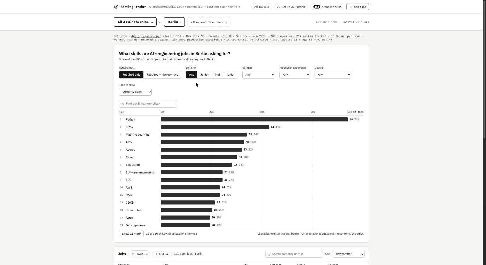

# hiring-radar

**What skills is the AI-engineering job market actually asking for — and how does that
differ by city?**

Job ads are written to be read one at a time, so nobody can tell whether "RAG experience"
is in 5% of postings or 50%. hiring-radar reads them in bulk and answers that with a
number.

It pulls postings from company job boards, maps each one to a fixed list of skills with an
LLM, and charts how many *distinct jobs* mention each skill. One posting shouting
"Python, Python, Python" counts once.

Today it holds 562 postings from 200 companies across four markets — San Francisco,
Berlin, New York and EU-remote. 421 of those are still open, and the chart reads the 414
open postings with a full description (a posting under 400 characters is a fragment and
stays out):

| skill | jobs asking for it | share of the 414 |
|---|---|---|
| Python | 256 | 62% |
| LLMs | 155 | 37% |
| Machine Learning | 143 | 35% |
| Evaluation | 128 | 31% |
| Software engineering | 90 | 22% |
| Agents | 89 | 21% |

Those are all four markets together. Berlin alone (103 open postings) reads Python 74%,
LLMs 43%, Machine Learning 34%; San Francisco (273) reads Python 56%, LLMs 36%, Machine
Learning 34%. `uv run python -m app stats` prints the posting counts; the skill counts are
what `/api/skills` returns with no filters set, which is what the dashboard opens on.

## Why trust the numbers

A chart built by an LLM is only as good as the extraction behind it, so extraction is
measured, not assumed:

- **46 job descriptions are hand-labeled** with the skills they truly ask for. Scoring the
  current extractor against the 20 development ones gives **F1 0.920** (precision 0.876,
  recall 0.968) — `evals/results/20261105T105022Z_dev_x2-7873e921da`.
- **The other 26 labeled ads are held out** and never looked at while tuning, so the score
  can't quietly become a score of how well the test was memorized. They are read only at
  release points; the last held-out run scored F1 0.919 on the extractor as it stood on
  30 October (`evals/results/20261030T123219Z_heldout_x2-2e0cac6944`).
- **Skills live in a versioned list**, not in the prompt. A skill the list doesn't know
  never reaches the chart — it goes to a review queue instead. 139 different labels are
  waiting there now, and one earns a permanent entry once three separate jobs ask for it.
- **Every extracted skill carries the sentence it came from.** Click a job in the
  dashboard and you see the quote, so any number can be traced back to the words.



You open the site on one question — **[AI Engineer] in [Berlin]** — pick a city and a job
family from the two dropdowns, and get that market'''s chart. Every market has its own
address (`/berlin/ai-engineer`), so a link to one is a link anyone can open, and the first
visit shows a card per city to choose from. "Compare with another city" puts two or three
markets side by side. More screens in [docs/screens/](docs/screens/).

Each job also gets seniority, German-language requirement, degree expectations, and
whether it asks for production experience — the four things that decide whether a posting
is worth reading at all.

Every job is also sorted into one of five job families — AI Engineer, ML Engineer, Data
Scientist, ML Platform, Research — from its title alone, and the dashboard filters the
chart, the related-skills panel, the skill tree and the job list by family the same way it
filters by city and seniority (DECISIONS, 2026-11-05).

## What this means for you

The market view is half the point. The other half is which of those skills you already
have. You describe yourself once — role, seniority, German, degree, the skills you'd
claim — and the dashboard reads the whole corpus back through that: how much of each
posting's ask you cover, and which in-demand skills you're missing.

Your profile stays in your browser's local storage. The server never sees it, so there's
no account and nothing to upload.

**Next up:** matching postings to a profile end to end — ranking jobs by how well you
cover them and naming the specific gap per job — turning "421 open jobs" into the
shortlist you could plausibly get, and the few skills standing between you and the rest.

## What it is not

No résumé *tailoring* — the tool tells you what the market wants and where you stand, it
does not rewrite your CV per posting. No email parsing, no applicant counts, nothing that
needs LinkedIn. Those were in the predecessor and were cut deliberately
([DECISIONS.md](DECISIONS.md), 2026-10-16).

**Status:** working locally — intake, extraction, evaluation, and dashboard all run. 64
job-board feeds are polled (67 are configured, 3 switched off). Collection covers Germany
and EU-remote, plus two cities turned on by name: San Francisco and New York, both on
2026-11-03 (DECISIONS 2026-11-03). Those two are named exceptions, not a general opening
to non-German cities. Comparison holds up to three cities at once. Adding a city to the
dashboard is one entry in `PLACES` (`web/src/format.js`) with its name, URL slug and
country group — the picker, the market grid, compare and the URLs all read that one list
(DECISIONS 2026-11-06). Runs 24/7 on a GCP VM with a daily 07:00 poll; ops runbook in
[deploy/README.md](deploy/README.md).

This is a rebuild of
[job-skills-dashboard](https://github.com/chandlershortlidge/job-skills-dashboard), a
one-day hackathon project whose extraction plateaued for structural reasons.
[DECISIONS.md](DECISIONS.md) records what went wrong and every choice made since.

---

# Technical details

## Quick start

```bash
uv sync
uv run pytest                 # model calls are always mocked

git config core.hooksPath .githooks   # once per clone: the branch guard below

cp .env.example .env          # add your Anthropic API key (gitignored)

uv run python -m app poll     # fetch feeds → ingest → extract
uv run python -m app serve    # dashboard at http://127.0.0.1:8000
```

The dashboard needs a frontend build first (`cd web && npm install && npm run build`).
To see the UI without any model calls:

```bash
HIRING_RADAR_DB=/tmp/demo.db uv run python scripts/seed_demo.py
```

### The branch guard

`git config core.hooksPath .githooks` points git at `.githooks/pre-commit`, which refuses
a commit on `main`/`master`, and on any branch whose name does not contain the issue id in
a `TICKET` file at the repo root. `TICKET` is one line, gitignored, and written once per
branch:

```bash
git switch -c you/hir-NN-short-description
echo HIR-NN > TICKET
```

The config is per clone — git will not run a hook a repository hands it by default, so a
fresh clone has no guard until you set it.

## How a job becomes a row in the chart

```
feeds / pasted link / pasted text / screenshot
        │
        ├─ screenshot only → vision call → verbatim transcript   (app/transcribe.py)
        │
        ▼
  ingest: new, still-listed, merge, or repost?                   (app/ingest.py)
        │   filtered by title regex and active city
        ▼
  extract: one tool call → skill ids + requirement + quote,      (app/extract.py)
        │   plus seniority / German / degree / production experience,
        │   each with a quote or none
        │   unknown labels → proposed_skill, never the chart
        ▼
  aggregate: document frequency per skill, per city              (app/queries.py)
```

Postings under 400 characters are treated as fragments and excluded from the chart
(DECISIONS, 2026-10-21).

## Stack

- Python 3.13, `uv`, FastAPI. Anthropic SDK called in-process.
- SQLite, single file, numbered migrations in `app/migrations/`.
- React 18 + Vite in `web/`, no chart library (CSS bars), served by the same process.

## Intake commands

```bash
uv run python -m app poll --no-extract          # fetch + ingest only, no model calls
uv run python -m app poll --only ashby:jupus    # one named feed
uv run python -m app extract                    # extract anything still pending
uv run python -m app check <url>                # in the DB? if not, why no feed had it
uv run python -m app discover-boards            # find boards we don't poll yet
uv run python -m app stats

pbpaste | uv run python -m app add-text --company "Acme" --title "AI Engineer" \
  --location Berlin --found-via linkedin
uv run python -m app add-screenshot shot.png --company "Acme" --title "AI Engineer" \
  --location Berlin
```

## Evaluation

```bash
uv run python scripts/run_eval.py --repeats 1   # quick look, ~20 model calls
uv run python scripts/run_eval.py               # dev split, 3 repeats
```

Results land in `evals/results/<run_id>/` with a `summary.md`. Metrics are
micro-averaged precision/recall/F1 plus requirement accuracy, Spearman rank correlation,
and top-10 overlap of skill frequencies. Held-out Goldens are read only at release
points.

## Layout

| path | what lives there |
|---|---|
| `app/sources/` | one adapter per feed (Greenhouse, Lever, Ashby, JOIN, Arbeitnow, …) |
| `app/ingest.py` | the new / still-listed / merge / repost decision, title + city filters |
| `app/extract.py` | JD text → skill mentions and per-job attributes |
| `app/evaluation.py` | scoring and the eval suite runner |
| `app/queries.py` | the read queries behind the dashboard |
| `app/api.py` | FastAPI routes plus the add-a-job paths |
| `taxonomy/skills.json` | the skill list — source of truth (v10, 217 entries) |
| `evals/goldens/` | labeled JDs with a `dev` / `heldout` split |
| `config/feeds.json` | which boards get polled |
| `web/src/profile.js` | the local profile and skill-overlap coverage (never sent to the server) |
| `web/src/` | the rest of the frontend |

Three layout rules: imports flow one direction, I/O is split from pure logic so the logic
can be tested, and every module opens with a docstring saying what it does *not* do.

Working in this repo (human or agent)? Read [AGENTS.md](AGENTS.md) first.

MIT licensed.
